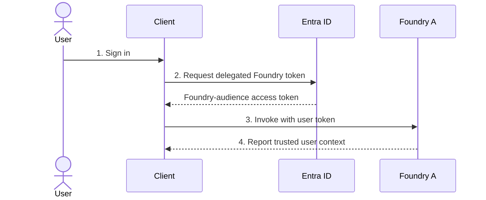
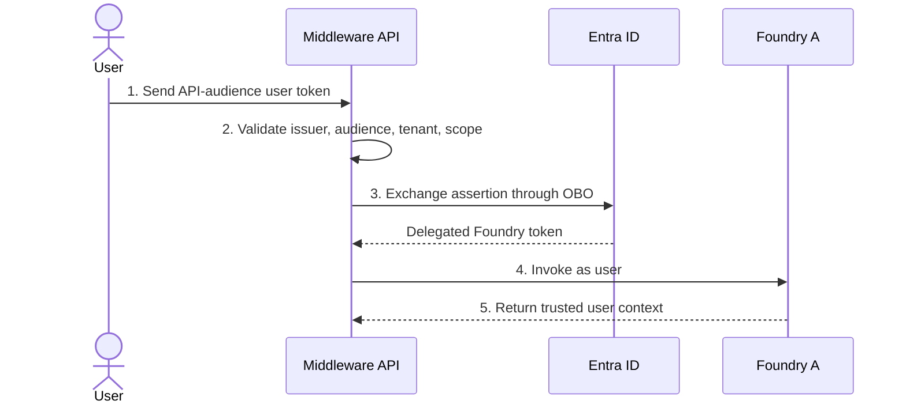
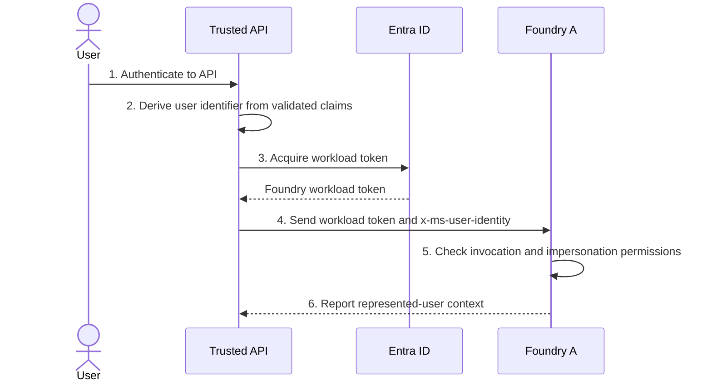
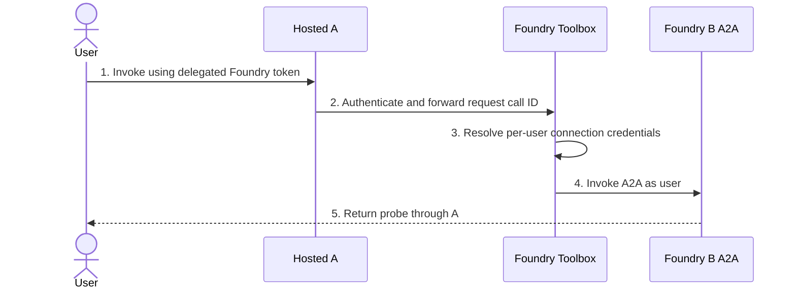
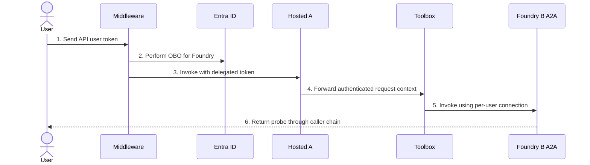
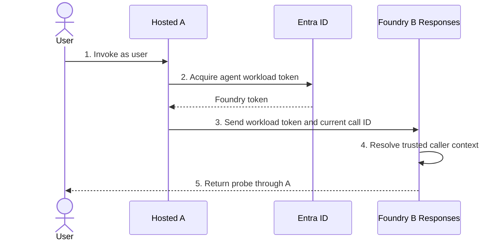
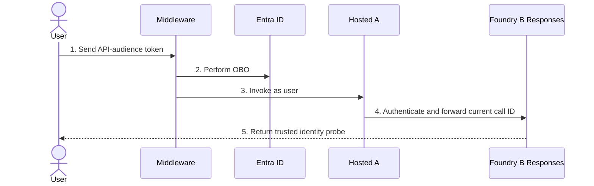
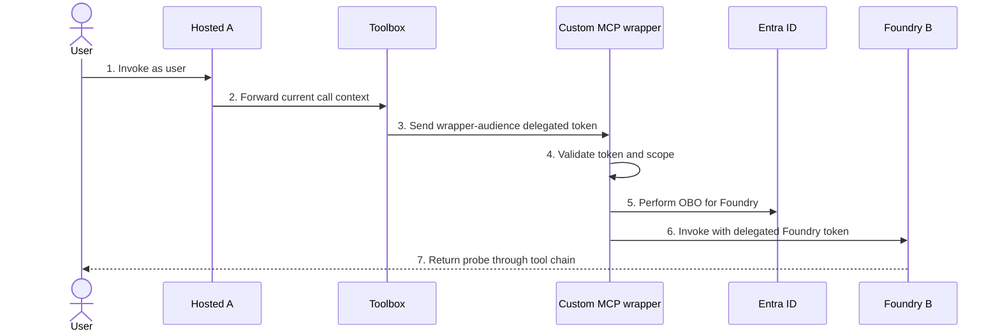
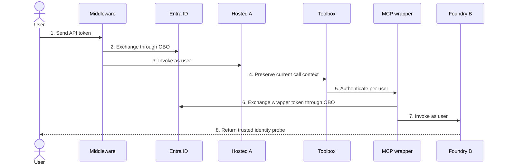

# Foundry identity flows

A public specification and Python implementation lab for Microsoft Foundry user
identity propagation. Infrastructure uses **Azure Developer CLI (`azd`) + Bicep**.

**Status: deployed implementation preview; two-user identity evidence remains NOT RUN.**
The [single-operator smoke](docs/deployment.md#recorded-single-operator-smoke)
verified direct invocation but found missing user identity in chained Responses.
Diagrams describe experiments, not universal propagation guarantees.

## Pattern index

| Pattern | Flow | Implementation |
|---|---|---|
| [P01](#p01-direct-user-invocation) | User -> Foundry | [Runner](src/identity_lab/cli.py), [probe](src/identity_lab/hosted.py) |
| [P02](#p02-middleware-obo) | User -> API -> Foundry, delegated OBO | [API](src/identity_lab/api.py), [OBO](src/identity_lab/auth.py) |
| [P03](#p03-trusted-backend-delegation) | User -> API -> Foundry, workload + represented user | [API](src/identity_lab/api.py) |
| [P04](#p04-direct-user-a2a) | User -> A -> B, A2A | [Hosted routing](src/identity_lab/hosted.py) |
| [P05](#p05-middleware-obo-a2a) | User -> API -> A -> B, A2A | [API](src/identity_lab/api.py), [hosted routing](src/identity_lab/hosted.py) |
| [P06](#p06-direct-user-responses-chain) | User -> A -> B, Responses | [Hosted routing](src/identity_lab/hosted.py) |
| [P07](#p07-middleware-obo-responses-chain) | User -> API -> A -> B, Responses | [API](src/identity_lab/api.py), [hosted routing](src/identity_lab/hosted.py) |
| [P08](#p08-direct-user-mcp-wrapper) | User -> A -> MCP wrapper -> B | [MCP wrapper](src/identity_lab/api.py) |
| [P09](#p09-middleware-obo-mcp-wrapper) | User -> API -> A -> MCP wrapper -> B | [API and wrapper](src/identity_lab/api.py) |

Each pattern below starts with a sequence diagram, then enumerated steps, then
its acceptance criteria. See [configuration](docs/configuration.md),
[deployment](docs/deployment.md), [evidence](docs/evidence.md), and
[sources/provenance](docs/sources.md).
Private troubleshooting telemetry is described in [observability](docs/observability.md).
The [normative specification](docs/specification.md) defines trust boundaries
and acceptance requirements.

## What this lab measures

Agents A and B use a **deterministic protocol-2.0 Responses handler**, not a model,
to remove LLM behavior from authentication experiments. B reports the trusted
platform user context to authenticated callers. The runner compares it with each
user's direct B baseline. Runner raw evidence stays under ignored `.local/`;
private Azure platform diagnostics have independent collection policies.

The acceptance criteria measure identity continuity, **not universal downstream data authorization**.
P03 tests represented-user context, not OAuth delegated access. Per-user Graph,
database ACL, session-ownership, cross-tenant, and channel-specific behavior need
additional tests before making those claims.

**A2A support caveat:** current incoming-A2A documentation names prompt agents
as its prerequisite; P04/P05 target hosted B and remain conditional, potentially
BLOCKED experiments. The lab does not assume that every Responses-compatible
hosted agent supports incoming A2A. See the [support gate](docs/configuration.md#a2a-and-toolboxes).

| Configuration | Expected observation | Successful test |
|---|---|---|
| `user` | B resolves the invoking user's direct baseline | PASS: same user |
| `service` | B resolves a service, or an attributable target denial | PASS: different principal or proven target denial |
| `drop-context` | B does not resolve the original user, or target denies | PASS: different principal or proven target denial |

**A negative-test PASS does not mean user identity propagated.** Unattributed
401/403 responses, consent interruptions, missing tool configuration, and missing
probe output are BLOCKED, never evidence of successful authorization.

### P01 Direct user invocation



1. Sign in as an authorized test user.
2. Acquire a delegated token for Foundry.
3. Invoke A using that token.
4. Compare A's trusted user context with the user's direct B baseline.

| Check | Expected | Observed |
|---|---|---|
| Each user retains identity | Same user | NOT RUN |
| Distinct users remain distinct | Different baselines | NOT RUN |

Configure user endpoint access and the public client as described in
[configuration](docs/configuration.md#direct-clients).
Authority: [per-user isolation](https://learn.microsoft.com/azure/foundry/agents/how-to/isolate-sessions-per-user).

### P02 Middleware OBO



1. Acquire a user token intended for the middleware API.
2. Validate the token before processing the request.
3. Exchange it for a delegated Foundry token.
4. Invoke A with the resulting token.
5. Compare the returned identity with the user's direct baseline.

| Check | Expected | Observed |
|---|---|---|
| OBO preserves the user | Same user | NOT RUN |
| Wrong audience or missing scope | API rejects request | NOT RUN |

Configure [middleware permissions](docs/configuration.md#middleware-obo).
Authority: [Entra OBO](https://learn.microsoft.com/entra/identity-platform/v2-oauth2-on-behalf-of-flow).

### P03 Trusted backend delegation



1. Authenticate the user to the backend.
2. Derive the user identifier from validated claims.
3. Authenticate the backend separately to Foundry.
4. Set the represented-user header on the request.
5. Require explicit impersonation permission.
6. Inspect identity consistency without claiming downstream OAuth authorization.

| Check | Expected | Observed |
|---|---|---|
| Authorized backend represents a user | Trusted represented-user context | NOT RUN |
| Missing impersonation permission | Foundry rejects with 403 | NOT RUN |
| Header alone grants downstream access | Never | NOT RUN |

The runner compares direct and represented contexts as an **experiment**. A
different opaque identifier is not automatically proof of a permissions failure;
investigate the runtime's delegated identifier mapping before drawing conclusions.
The runner cannot certify delegated session isolation or downstream permissions.
Configure [backend delegation](docs/configuration.md#backend-delegation).
Authorities: [delegation permission](https://learn.microsoft.com/azure/foundry/agents/concepts/hosted-agent-permissions#delegate-the-end-user-identity),
[OBO versus forwarding](https://learn.microsoft.com/azure/foundry/agents/how-to/use-on-behalf-of-flow).

### P04 Direct user A2A



1. Authenticate directly to A as the user.
2. Forward the current call ID to the toolbox.
3. Resolve the user-authenticated A2A connection.
4. Invoke B under the authorized user's identity.
5. Compare B's context with the user's direct baseline.

| Check | Expected | Observed |
|---|---|---|
| UserEntraToken connection | Same user | NOT RUN |
| AgenticIdentity connection | Service identity or target denial | NOT RUN |
| Missing call context | Different identity or denial | NOT RUN |

Configure [A2A](docs/configuration.md#a2a-and-toolboxes).
Authorities: [incoming A2A](https://learn.microsoft.com/azure/foundry/agents/how-to/enable-agent-to-agent-endpoint),
[A2A authentication](https://learn.microsoft.com/azure/foundry/agents/concepts/agent-to-agent-authentication).

### P05 Middleware OBO A2A



1. Validate the middleware's incoming user token.
2. Exchange it for a Foundry delegated token.
3. Invoke A as the user.
4. Preserve the request-scoped call ID.
5. Authenticate the A2A hop using the user connection.
6. Compare B's identity with the user's direct baseline.

| Check | Expected | Observed |
|---|---|---|
| Delegated entry plus user A2A | Same user | NOT RUN |
| Service A2A connection | Different principal or target denial | NOT RUN |

Configure both [middleware OBO](docs/configuration.md#middleware-obo) and
[A2A](docs/configuration.md#a2a-and-toolboxes).
Authorities: [Entra OBO](https://learn.microsoft.com/entra/identity-platform/v2-oauth2-on-behalf-of-flow),
[toolbox authentication](https://learn.microsoft.com/azure/foundry/agents/how-to/tools/tool-authentication).

### P06 Direct user Responses chain



1. Invoke hosted A with the user's delegated token.
2. Authenticate A's outbound request using its workload identity.
3. Forward the current opaque Foundry call ID unchanged.
4. Let Foundry resolve the represented caller.
5. Compare B's trusted context with the user's direct baseline.

| Check | Expected | Observed |
|---|---|---|
| Workload auth plus call context | Same user | NOT RUN |
| Workload auth without call context | Different principal or target denial | NOT RUN |

Configure [Responses chaining](docs/configuration.md#responses-chaining).
Authority: [protocol-2.0 runtime contract](https://learn.microsoft.com/azure/foundry/agents/concepts/hosted-agent-contract#platform-request-headers-container-protocol-200).

### P07 Middleware OBO Responses chain



1. Validate the API-audience user token.
2. Acquire a delegated Foundry token through OBO.
3. Invoke A with that token.
4. Forward request context when A calls B.
5. Compare B's identity with the user's direct baseline.

| Check | Expected | Observed |
|---|---|---|
| Both boundaries preserve context | Same user | NOT RUN |
| Missing A-to-B call ID | Different principal or target denial | NOT RUN |

Configure [middleware OBO](docs/configuration.md#middleware-obo) and
[Responses chaining](docs/configuration.md#responses-chaining).
Authority: [identity propagation migration](https://learn.microsoft.com/azure/foundry/agents/how-to/migrate-hosted-agent-preview#container-protocol-200).

### P08 Direct user MCP wrapper



1. Authenticate directly to A.
2. Preserve context at the toolbox boundary.
3. Authenticate the custom MCP connection per user.
4. Validate the wrapper's incoming token.
5. Exchange that token for Foundry through OBO.
6. Invoke B as the delegated user.
7. Compare B's trusted identity with the direct baseline.

| Check | Expected | Observed |
|---|---|---|
| OAuth wrapper plus OBO to B | Same user | NOT RUN |
| Service token to user-only wrapper | Wrapper rejects; investigate denial attribution | NOT RUN |

There is no application-entry middleware here, but the **MCP wrapper is still a
middle tier**. This is not the same as a toolbox exposing an A2A tool over MCP.
Configure the [custom wrapper](docs/configuration.md#custom-mcp-wrapper).
Authorities: [custom MCP authentication](https://learn.microsoft.com/azure/foundry/agents/how-to/mcp-authentication),
[OBO audience requirements](https://learn.microsoft.com/entra/identity-platform/v2-oauth2-on-behalf-of-flow).

### P09 Middleware OBO MCP wrapper



1. Validate the middleware user token.
2. Perform OBO for Foundry.
3. Invoke A using the delegated token.
4. Preserve request context when accessing tools.
5. Obtain a wrapper-audience user token through connection OAuth.
6. Perform another OBO exchange inside the wrapper.
7. Invoke B using the new Foundry token.
8. Compare B's context with the user's direct baseline.

| Check | Expected | Observed |
|---|---|---|
| All boundaries configured per user | Same user | NOT RUN |
| Shared credentials replace user credentials | Different identity or denial | NOT RUN |

Configure [middleware](docs/configuration.md#middleware-obo) and
[wrapper OAuth](docs/configuration.md#custom-mcp-wrapper).
Authority: [toolbox authentication](https://learn.microsoft.com/azure/foundry/agents/how-to/tools/tool-authentication).

## Run locally

Use Python 3.11 or later and your organization's approved package feeds:

```bash
python3.12 -m venv .venv
. .venv/bin/activate
python -m pip install -c requirements.lock.txt -e '.[hosted]'
PYTHONPATH=src python -m unittest discover -s tests -v
python scripts/check_public.py
```

Live instructions: [deployment](docs/deployment.md). No cloud deployment runs from
CI, and no directory permissions are granted automatically.

## Public repository rules

Never commit real tenant, subscription, principal, application, or resource IDs,
tenant-specific endpoints, credentials, raw responses, identity hashes, or logs.
Keep runtime configuration, deployment outputs, and raw evidence in `.local/`
or `.azure/`, both ignored. Use only identity aliases in published evidence.
See [publication policy](PUBLICATION.md) before committing any results.
