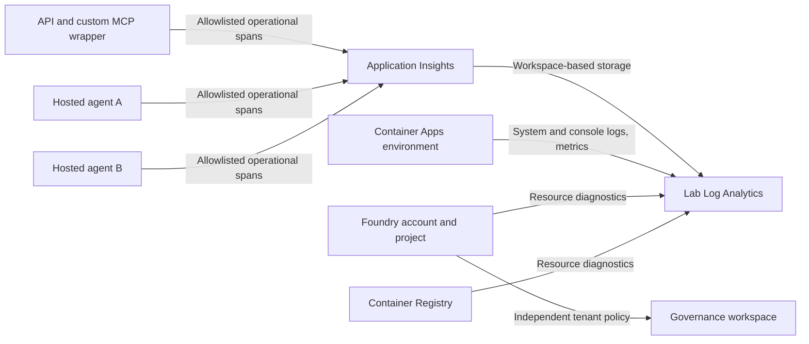

# Private lab observability

**Live operational ingestion is verified in the reference deployment.**
API HTTP 200/401, hosted HTTP 200, A-to-B dependency spans, and cross-agent parent
links were observed. This does not establish passing identity propagation.
See the [bounded smoke results](deployment.md#recorded-single-operator-smoke).

## Diagnosing execution errors before identity tests

The 2026-10-23 baseline exposed two execution defects, not identity failures:
the API image lacked `aiohttp` for asynchronous managed-identity authentication,
and unconfigured toolbox routes raised a generic endpoint-validation exception.
`aiohttp` is now an explicit constrained runtime dependency. Image regression
checks construct the actual asynchronous credential without contacting Azure.

Toolbox routes validate endpoints, tool names and JSON argument objects before
requesting credentials. An empty argument setting means `{}`, not invalid JSON.
Known prerequisite failures return a fixed `identity-lab-error-v1` diagnostic
with `toolbox-not-configured`, `toolbox-schema-invalid`, or
`toolbox-tool-unavailable`; these are not identity probes or successful tests.
The middleware maps them to HTTP 503. A tool-reported execution failure maps
to HTTP 502. Unexpected defects are not silently converted into prerequisites.

The hosted Responses protocol carries this diagnostic as output text; its
completed HTTP 200 envelope does not mean the tool executed. The lab transport
recognizes the fixed diagnostic and raises it for the middleware or caller.
The handler span records the allowlisted `lab.error.code` and failure status
without raw exception messages, tokens, endpoints or user identifiers.
Query `customDimensions['lab.error.code']` on handler dependencies alongside
request/dependency HTTP outcomes. Toolbox connections still require explicit
configuration and consent; diagnostic handling does not configure them.

**Remaining gap:** Container Apps console/system persistence is NOT VERIFIED.
Both enabled categories and the correct workspace were read back; direct live
streaming and a named-revision cold start worked. No console/system rows appeared
during bounded checks after moving from legacy shared-key to Azure Monitor
routing, including a retry with documented default table routing. Do not report
that source as successfully ingested or weaken workspace authentication to hide
the gap. Foundry diagnostics, registry events, metrics, and application spans
were observed independently.



## What goes where

| Source | Lab destination | Coverage |
|---|---|---|
| API and MCP wrapper | Application Insights / lab workspace | Requests, authentication exchanges, outbound Responses calls |
| Hosted A and B | Same Application Insights / lab workspace | Handler requests, workload authentication, Responses and toolbox dependencies |
| Container Apps | Lab workspace | Azure Monitor diagnostic routing for system/console logs and environment/API metrics |
| Foundry account | Lab workspace | `allLogs` and `AllMetrics` diagnostic setting |
| Foundry project | Lab workspace | `allLogs` diagnostic setting |
| Registry | Lab workspace | `allLogs` and `AllMetrics`, resource-specific tables |

The root infrastructure has eight primary resources, one project monitoring
connection, and five resource-scoped
diagnostic settings. The component references the existing lab workspace; it does
not create another workspace or duplicate Application Insights export settings.
Container Apps uses `azure-monitor`, not legacy workspace shared-key ingestion.
The original stack pattern hardcodes shared-key logging, which produced no
console/system tables with this Entra-only workspace. The lab therefore composes
the same pinned registry/environment resource modules with explicit routing.
Governance settings are not replaced, disabled, or redirected.

The diagnostic-setting AVM is subscription-wide, so it is deliberately not used.
This lab does not export unrelated subscription activity into its workspace.
Inspect the resource group's Activity Log separately when diagnosing deployment
failures. Supported resource categories and emission still require live checks;
do not silently remove a failing source or upgrade a SKU without approval.

## Application telemetry privacy and authentication

`LAB_TELEMETRY_ENABLED=true` enables the manual OpenTelemetry exporter.
`LAB_APPLICATIONINSIGHTS_CONNECTION_STRING` must explicitly identify the lab
component. Hosted service roles are `identity-agent-a` and `identity-agent-b`;
the API role is `identity-api`. Offline runs default to telemetry disabled.

The exporter uses explicit platform credentials with Entra-authenticated
ingestion. Application Insights disables local authentication and retains IP
masking. Each API/agent workload needs **Monitoring Metrics Publisher** at the
**single Application Insights component**, not at subscription scope. A connection
string alone does not authorize ingestion. These grants are not automatic.
The project's managed identity needs the same component-scoped publisher role
for Foundry-owned trace ingestion.

Only fixed operation names, scenario/configuration labels, normalized routes,
Allowlisted HTTP methods/result codes, timing, and W3C trace context are recorded.
Request/response bodies, raw probes, user identifiers, bearer tokens, secrets,
arbitrary URLs/query strings, exception messages, and stack traces are excluded
from these application spans. Automatic GenAI instrumentation, SDK statistics,
control-plane telemetry configuration, and offline exporter storage are disabled.
The hosted SDK's default content-observability setup remains disabled.

These controls do **not** sanitize Azure platform diagnostics. Audit/resource
logs can contain resource or identity metadata under Azure and tenant policy.
The project monitoring connection also enables Foundry-owned server-side tracing,
which can capture content independently of the manual span allowlist.
Treat both workspaces as private and review retention, access, and content
capture with the environment owner. Never copy raw logs into public evidence.

## Correlation without identity delegation

Direct lab HTTP calls forward standard `traceparent` and an
`x-client-traceparent` copy for supported Foundry client-header forwarding.
The receivers extract only W3C trace context, not baggage or arbitrary headers.
Managed A2A/toolbox services may not preserve it; separate trace roots are an
honest correlation gap, not proof that user identity was lost.

The hosted SDK dispatches handlers outside the ASGI request task. An internal
trace-header bridge parents the handler span to its HTTP request without
forwarding bearer tokens, user context, baggage, or arbitrary headers.
The response sender can also lose task context; status recording targets the
captured request span directly. The exporter receives the private tracer provider
explicitly instead of assuming a globally registered provider.

Trace headers never replace `x-agent-foundry-call-id`, OBO, or permission grants.
Dropping identity context in a negative test does not need to drop operational
trace correlation. A completed span is not a passing identity observation.

## Deploy-time configuration

The API gets its lab connection string through a Container Apps secret reference.
The root azd output `APPLICATIONINSIGHTS_CONNECTION_STRING` must also be supplied
to the hosted azd project's **private** environment before deploying A/B.
The manifest maps it to the lab-prefixed variable. The project also needs an
`AppInsights` connection targeting that same component, with authentication
`ProjectManagedIdentity` and metadata `ApplicationInsightsConnectionString`.
The service requires this preview authentication type even though the published
Bicep schema currently emits BCP036 for it; the deployed service accepted it.

`APPLICATIONINSIGHTS_CONNECTION_STRING` is platform-reserved: do not set it in
agent environment configuration or override it in code. Foundry injects it
through project monitoring. The exporter eagerly parses this ambient setting even
with an explicit lab connection string. In the reference deployment, the first
hosted session failed startup until the project monitoring connection was created.
An `active` agent version alone was not sufficient evidence of runtime readiness.

Both images install the constraint-pinned exporter explicitly. The AVM azd
monitoring pattern was evaluated, but does not expose the required workspace
quota and Entra-only/IP-masking controls. The lab instead retains its workspace
and adds the pinned AVM Application Insights component.
Build them explicitly with the approved feed mounted as a BuildKit secret, then
use the prebuilt-image azd path in [deployment](deployment.md). Native
`docker.buildArgs` are not a safe mechanism for passing that secret.

The workspace's 30-day retention and 1 GB/day quota cover the shared lab stream.
Quota enforcement can lag, and collection stops after a cap is reached.
Governance workspaces/security services have independent settings and charges.
Neither quota nor sampling is an enforceable US-dollar spending cap.

## Ingestion verification and troubleshooting

After approved deployment and publisher grants, call `/health`, attempt an
unauthenticated API invocation, then run one approved identity scenario.
Allow ingestion latency and query **Logs on the lab workspace**:

```kusto
union withsource=Table AppRequests, AppDependencies
| where TimeGenerated > ago(1h)
| where AppRoleName in ("identity-api", "identity-agent-a", "identity-agent-b")
| project TimeGenerated, Table, AppRoleName, Name, OperationId, ParentId,
          ResultCode, Success, DurationMs, Properties
| order by TimeGenerated asc
```

Confirm a request for each exercised service, the expected 401 denial, and a
Responses dependency. Match `OperationId` and parent links where forwarding is
supported; do not require a single trace across managed hops without evidence.
For the Application Insights Logs view, use its `requests`/`dependencies`
aliases and `operation_Id` rather than mixing workspace table schemas.

Check independent platform sources:

```kusto
union withsource=LabSourceTableName *
| where TimeGenerated > ago(1h)
| summarize Records=count(), LastSeen=max(TimeGenerated) by LabSourceTableName
```

Look for `AzureDiagnostics`, `AzureMetrics`, the registry event tables, and the
Container Apps console/system tables emitted by the selected logging mode.
Table names can differ between Azure Monitor and legacy direct-workspace routing.
Tables appear only after emission. Exercise the relevant resource and inspect
its diagnostic settings and category availability when rows are missing.
For telemetry failures, check publisher scope, explicit workload credential,
the lab connection-string mapping, egress, SDK export errors in console logs,
and workspace quota. Missing rows are not a successful ingestion check.

## Authoritative guidance

- [Application Insights Entra ingestion](https://learn.microsoft.com/azure/azure-monitor/app/azure-ad-authentication)
- [Foundry Entra-authenticated trace ingestion](https://learn.microsoft.com/azure/foundry/observability/how-to/trace-ingestion-entra-authentication)
- [Hosted telemetry and reserved settings](https://learn.microsoft.com/azure/foundry/agents/how-to/configure-hosted-agent-telemetry)
- [Foundry diagnostics](https://learn.microsoft.com/azure/foundry/how-to/diagnostic-logging)
- [Container Apps logging](https://learn.microsoft.com/azure/container-apps/log-monitoring)
- [Registry monitoring](https://learn.microsoft.com/azure/container-registry/monitor-container-registry)
- [Resource diagnostic settings](https://learn.microsoft.com/azure/azure-monitor/essentials/diagnostic-settings)
